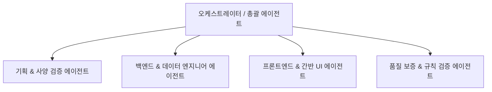

# 영업 파이프라인 관리 자동화 시스템 설계 지침서 (AGENTS.md)

> **문서 목적**: 본 지침서는 AI 에이전트(Antigravity 등)와 개발자가 '영업 파이프라인 관리 자동화 시스템'을 일관되고 안정적으로 설계·구현하기 위한 단일 기준 문서(Single Source of Truth)이자 계획서입니다.

---

## 1. 프로젝트 개요 및 배경

- **프로젝트명**: 영업 파이프라인 관리 (Sales Pipeline Management)
- **목표**: 영업 기회 발굴부터 수주/실패에 이르는 파이프라인 관리 업무를 자동화하고 시각화하여 영업 생산성을 극대화한다.
- **최종 결과물**: 직관적인 인터랙션(Drag & Drop 등)을 지원하는 **영업 파이프라인 간반보드(Kanban Board) 관리 웹 애플리케이션**

---

## 2. 업무 흐름 (Business Workflow)

```mermaid
flowchart LR
    A[영업 기회 생성] --> B[파이프라인 등록\n기본 상태: 리드/접촉]
    B --> C[영업 액티비티 기록\n미팅, 제안서, 통화 등]
    C --> D[상태 전이\n간반보드 이동]
    D --> E{최종 결과}
    E -->|성공| F[수주 완료 (Won)]
    E -->|실패/중단| G[실패/취소 (Lost/Canceled)]
```

1. **리드/기회 등록**: 영업 담당자 또는 시스템이 기본 영업 파이프라인 항목을 생성합니다.
2. **영업 활동 전개**: 미팅, 전화, 메일, 데모, 제안서 제출 등 액티비티를 지속적으로 기록합니다.
3. **간반보드 기반 상태 변경**: 진행 상황에 따라 카드를 단계별 컬럼으로 이동시킵니다.
4. **결과 확정**: 마감일 도래 또는 협상 결과에 따라 수주 성공(Won), 실패(Lost), 취소(Canceled)로 완결됩니다.

---

## 3. 데이터 모델 및 제약 사항

### 3.1. 파이프라인 (Sales Pipeline)
| 필드명 | 타입 | 필수 여부 | 설명 |
| :--- | :--- | :---: | :--- |
| `id` | UUID / String | Y | 고유 식별자 |
| `title` | String | Y | 딜/영업건 제목 |
| `client_name` | String | Y | 고객사명 |
| `amount` | Number | Y | 예상/계약 금액 (통화 단위 고려) |
| `status` | Enum | Y | 진행 상태 (예: Lead, Contact, Proposal, Negotiation, Won, Lost, Canceled) |
| `created_by` | String | Y | 생성자 (영업 담당자 ID/이름) |
| `created_at` | DateTime | Y | 생성일시 |
| `closing_date` | Date | N | 목표 마감일 |
| `canceled_date`| DateTime | N | 취소/실패 처리일시 |
| `updated_at` | DateTime | Y | 최종 수정일시 |

### 3.2. 액티비티 (Sales Activity)
| 필드명 | 타입 | 필수 여부 | 설명 |
| :--- | :--- | :---: | :--- |
| `id` | UUID / String | Y | 고유 식별자 |
| `pipeline_id` | UUID / String | Y | 대상 파이프라인 ID (Foreign Key) |
| `activity_date`| DateTime | Y | 활동일시 |
| `activity_type`| Enum | Y | 활동 유형 (전화, 대면미팅, 온라인미팅, 이메일, 견적/제안 등) |
| `assignee` | String | Y | 담당자 |
| `content` | Text | Y | 활동 상세 내용 및 결과 |
| `created_at` | DateTime | Y | 생성일시 |

### 3.3. 필수 비즈니스 규칙 및 제약사항 (Critical Rules)
> [!IMPORTANT]
> **삭제 불가 불변 규칙**:
> 1. 해당 파이프라인에 **액티비티가 1건 이상 등록된 경우** 삭제 불가
> 2. 초기 생성 상태에서 **상태(Status)가 한 번이라도 변경된 경우** 삭제 불가
>
> **구현 지침**:
> - 프론트엔드: 위 조건 만족 시 간반 카드 및 상세 모달 내 삭제(Delete) 버튼 비활성화(Disabled) 및 안내 툴팁 제공
> - 백엔드/API: 삭제 요청 수신 시 DB 검증을 통해 조건 위반 시 `400 Bad Request` 또는 `409 Conflict` 반환

---

## 4. 권장 디렉터리 구조

에이전트와 개발자가 모듈식으로 작업을 분담하고 추적할 수 있도록 아래 구조를 권장합니다.

```text
├── AGENTS.md                  # 본 에이전트 시스템 설계 및 작업 지침서
├── docs/                      # 설계서, API 명세, 회의록
│   └── architecture.md
├── artifacts/                 # 중간 산출물, 실행 계획서, 감사 로그 보관
│   ├── plans/
│   └── runs/
├── data/                      # 데이터 저장소 (로컬 SQLite/JSON 등 개발 데이터)
│   ├── migrations/
│   └── seeds/
├── src/
│   ├── frontend/              # 간반보드 웹 프론트엔드 (React / Next.js / Vite 등)
│   │   ├── components/        # KanbanBoard, KanbanColumn, PipelineCard, ActivityList
│   │   ├── hooks/
│   │   ├── services/
│   │   └── types/
│   └── backend/               # API 서버 및 비즈니스 로직
│       ├── controllers/
│       ├── services/
│       ├── models/            # Pipeline, Activity 엔티티 및 유효성 검증
│       └── middlewares/       # 비즈니스 규칙 검증기 (삭제 제한 등)
└── tests/                     # 품질 검증 테스트 스위트
    ├── unit/
    └── e2e/
```

---

## 5. 에이전트 구성 전략 (Agent Architecture)

프로젝트 규모와 복잡도에 따라 유연하게 역할을 분리합니다.



1. **총괄/오케스트레이터 (Lead Agent)**: 전체 작업 진행 단계 조율, 의존성 관리.
2. **사양 및 데이터 설계자 (Planner/Data Agent)**: 스키마 정의, API 인터페이스 계약 정의.
3. **백엔드 엔지니어 (Backend Agent)**: 비즈니스 불변 규칙(삭제 방지), 상태 전이 API, 데이터 영속화.
4. **프론트엔드 엔지니어 (Frontend Agent)**: 반응형 간반보드, 드래그 앤 드롭, 액티비티 타임라인 UI 구현.
5. **QA/검증 에이전트 (Validation Agent)**: 단위 테스트, 엣지 케이스 점검, 삭제 제한 규칙 검증.

---

## 6. 품질 검증 및 신뢰성 확보 전략 (Quality Gate)

모든 개발 단계는 아래의 4단계 프레임워크를 엄격히 준수합니다.

| 단계 | 수행 목표 | 완료 기준 (Definition of Done) | 검증 방법 | 실패 시 대응 |
| :--- | :--- | :--- | :--- | :--- |
| **1. 스키마/규칙 정의** | 데이터 모델 및 제약조건 수립 | 파이프라인/액티비티 타입 정의 완료 | 정적 타입 검사(TypeScript/Pydantic) | 스키마 재정의 및 자동 재검사 |
| **2. 비즈니스 로직** | 삭제 불가 조건 및 상태 변경 구현 | 제약조건 위반 시 삭제 차단 단위테스트 통과 | Jest / Pytest 자동화 테스트 | 실패 원인 로그 분석 후 자동 코드 수정/재시도 (최대 3회), 해결 불가 시 관리자 검토 |
| **3. 간반보드 UI** | 직관적인 카드 이동 및 실시간 갱신 | 드래그 이동 시 상태 반영 및 액티비티 추가 가능 | 컴포넌트 렌더링 테스트 & E2E 시나리오 | 렌더링 에러 감지 시 이전 안정 커밋/상태로 롤백 후 재수행 |
| **4. 통합/데이터 무결성** | 액티비티 보유 파이프라인의 안전성 보장 | 프론트/백 양단에서 무단 삭제 시도 차단 확인 | 통합 API 테스트 | 관리자에게 알림 및 승인 요청 (Human-in-the-Loop) |

---

## 7. 데이터 관리 및 변경 추적 (Data Management)

- **산출물 격리 보관**: 작업 중 생성되는 중간 데이터, 마이그레이션 이력, 에이전트 실행 로그는 `artifacts/` 및 `data/` 디렉터리에 버전별로 분리 저장합니다.
- **재실행성(Reproducibility)**: 
  - 시드 데이터(`data/seeds/`)를 준비하여 초기 간반보드 상태를 언제든 동일하게 재현할 수 있도록 합니다.
  - 파이프라인 상태 변경 및 액티비티 이력은 감사 로그(Audit Log) 형태로 기록을 남겨 추적성을 확보합니다.

---

## 8. 단계별 구현 절차 및 개발 시 고려사항

### 8.1. 실행 절차
1. **요구사항 확인 (Phase 1)**: 불필요한 질의를 지양하고, 미정 사항은 기본 표준값(Standard Defaults)을 채택하고 근거를 기록한다.
2. **시스템 및 API 설계 (Phase 2)**: 간반 컬럼 정의, 상태 전이 매트릭스, REST/GraphQL 엔드포인트 확정.
3. **점진적 구현 및 검증 (Phase 3)**:
   - 1차: 데이터베이스 및 코어 API (비즈니스 규칙 검증)
   - 2차: 간반보드 UI 및 액티비티 모달
   - 3차: 통합 검증 및 E2E 테스트

### 8.2. 개발 시 주요 고려사항
- **간반보드 사용자 경험 (UX)**: 상태 컬럼별 합계 금액(Total Amount), 건수 집계 표시.
- **예외 처리 시각화**: 삭제 제한 파이프라인의 삭제 시도 시 사용자 친화적인 설명 메시지 출력 ("활동 이력이 존재하거나 상태가 변경된 영업건은 삭제할 수 없습니다.").
- **성능 고려**: 카드가 많아질 경우 가상 스크롤(Virtual Scrolling) 또는 컬럼별 페이징/지연 로딩 적용.
