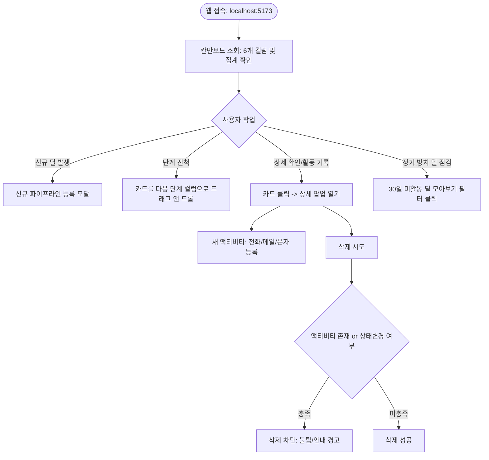

# 기능 요구사항 정의서 (FD.md - Functional Requirements Document)

> **문서 목적**: '영업 파이프라인 관리 자동화 시스템'의 화면 단위 기능 요구사항, 사용자 동작 방식(인터랙션), 비즈니스 로직 및 예외 처리 규칙을 구체적으로 정의한 명세서입니다.  
> **관련 문서**: [AGENTS.md](file:///c:/VIBECD/PRJ2/AGENTS.md) | [docs/architecture.md](file:///c:/VIBECD/PRJ2/docs/architecture.md) | [docs/api_specs.md](file:///c:/VIBECD/PRJ2/docs/api_specs.md)

---

## 1. 개요 및 사용자 흐름

### 1.1. 사용자 대상 (Persona)
- **1인 영업 실무자/대표**: 번거롭고 복잡한 설정 없이, 한눈에 영업 딜의 진행 상태와 액티비티를 파악하고 방치되는 영업 기회를 없애고자 함.

### 1.2. 핵심 사용자 여정 (User Journey)

---

## 2. 상세 기능 요구사항 (Functional Requirements)

### FR-01: 영업 파이프라인 칸반보드 (메인 화면)
- **FR-01-1 (6단계 컬럼 표시)**: 
  - 화면에 좌측부터 **[1. 리드] $\rightarrow$ [2. 제안] $\rightarrow$ [3. 미팅] $\rightarrow$ [4. 협상] $\rightarrow$ [5. 마무리] $\rightarrow$ [6. 취소]** 컬럼을 가로 배치합니다.
- **FR-01-2 (컬럼 헤더 집계)**:
  - 각 컬럼 상단에 **해당 단계의 카드 건수**와 **예상 금액 합계**를 실시간으로 합산하여 표시합니다. (예: `협상 (3건) | 합계 ₩75,000,000`)
- **FR-01-3 (카드 드래그 앤 드롭)**:
  - 카드를 마우스로 집어 다른 컬럼으로 이동시키면 즉시 백엔드 API Gateway(`PATCH /api/pipelines/:id/status`)로 JSON 요청을 전송하고 상태를 갱신합니다.
- **FR-01-4 (카드 정보 요약 표기)**:
  - 각 카드에는 **거래처명(굵은 글씨)**, **딜 제목**, **예상 금액(₩ 단위 천단위 콤마)**, **마감일**을 노출합니다.

---

### FR-02: 신규 파이프라인 등록 (모달)
- **FR-02-1 (등록 버튼)**:
  - 화면 상단 우측에 `[+ 새 파이프라인 등록]` 버튼을 배치합니다.
- **FR-02-2 (입력 폼 필드 및 유효성 검증)**:
  - **딜 제목 (title)**: 필수 입력 (문자열 2자 이상)
  - **거래처명 (client_name)**: 필수 입력
  - **예상 금액 (amount)**: 필수 입력 (0원 이상의 숫자)
  - **초기 단계 (status)**: 기본값 `리드(LEAD)` (드롭다운으로 선택 가능)
  - **담당자 (created_by)**: 필수 입력
  - **목표 마감일 (closing_date)**: 선택 입력 (달력 Datepicker)
- **FR-02-3 (완료 처리)**:
  - 등록 성공 시 칸반보드의 해당 컬럼 맨 위에 즉시 카드가 추가됩니다.

---

### FR-03: 파이프라인 상세 보기 & 액티비티 관리 (팝업 모달)
- **FR-03-1 (상세 팝업 오픈)**:
  - 칸반보드의 카드를 클릭하면 상세 팝업 모달이 열립니다.
- **FR-03-2 (기본 정보 조회 및 수정)**:
  - 거래처명, 딜 제목, 예상 금액, 목표 마감일 등을 수정할 수 있습니다.
- **FR-03-3 (액티비티 목록 표 형태 표시)**:
  - 해당 파이프라인에 등록된 모든 활동을 **최신순 표(Table)** 형태로 표시합니다.
  - 표 컬럼: **활동일시 | 활동유형(아이콘) | 담당자 | 내용 요약**
- **FR-03-4 (신규 액티비티 즉시 등록)**:
  - 모달 내에서 바로 활동을 추가할 수 있는 입력 폼을 제공합니다.
  - **유형 선택**: `메일 ✉️`, `전화 📞`, `문자 💬`, `기타 📌` 중 선택
  - **활동일시**: 기본값 현재 일시
  - **내용**: 텍스트 입력 후 `[활동 추가]` 클릭 시 즉시 표에 추가되고 백엔드에 저장됩니다.

---

### FR-04: 30일 장기 미활동 딜 자동 감지 및 보고
- **FR-04-1 (판별 기준)**:
  - 파이프라인의 `최종 액티비티 작성일` (액티비티가 없는 경우 `생성일`)로부터 **30일 이상 경과**한 경우
  - 단, 이미 종료된 `마무리` 및 `취소` 단계는 제외
- **FR-04-2 (시각적 경고 뱃지)**:
  - 해당 칸반 카드의 우측 상단에 붉은색 **`⚠️ 30일 미활동`** 뱃지를 달고, 카드 테두리에 은은한 붉은 하이라이트를 적용합니다.
- **FR-04-3 (상단 필터 기능)**:
  - 화면 상단에 **`[⚠️ 주의 필요한 딜 모아보기 (N건)]`** 토글 버튼을 제공합니다.
  - 클릭 시 30일 이상 미활동인 카드만 화면에 남기고 나머지는 필터링합니다.

---

### FR-05: 파이프라인 삭제 불가 비즈니스 불변 규칙
- **FR-05-1 (삭제 차단 조건)**:
  1. 등록된 **액티비티가 1건 이상** 있는 경우
  2. 최초 생성 시점의 상태에서 **상태(Status)가 한 번이라도 변경**된 경우
- **FR-05-2 (프론트엔드 UI 처리)**:
  - 상세 모달 내 `[삭제]` 버튼을 **비활성화(Disabled)** 처리하고 마우스 호버 시 툴팁을 띄웁니다:
    > *"활동 이력이 있거나 단계가 변경된 영업건은 데이터 무결성을 위해 삭제할 수 없습니다."*
- **FR-05-3 (백엔드 MSA 검증)**:
  - API Gateway $\rightarrow$ 파이프라인 서비스로 DELETE 요청이 들어오면, 파이프라인 서비스는 액티비티 서비스에 내부 통신으로 질의하여 활동 개수를 확인합니다.
  - 조건 위반 시 `400 Bad Request` 에러 JSON을 반환하여 직접 API 호출을 통한 임의 삭제도 원천 차단합니다.

---

## 3. 화면별 UI 컴포넌트 구조 매핑

| 컴포넌트명 | 파일 경로 (권장) | 주요 역할 |
| :--- | :--- | :--- |
| **App** | `src/App.jsx` | 메인 레이아웃, 상단 필터바, 모달 상태 관리 |
| **KanbanBoard** | `src/components/KanbanBoard.jsx` | 6개 컬럼 가로 래퍼 및 드래그 앤 드롭 컨텍스트 |
| **KanbanColumn** | `src/components/KanbanColumn.jsx` | 개별 단계 컬럼, 건수 및 합계 금액 헤더 |
| **PipelineCard** | `src/components/PipelineCard.jsx` | 개별 카드 UI, 거래처명, 금액, 30일 경고 뱃지 |
| **DetailModal** | `src/components/DetailModal.jsx` | 카드 클릭 시 열리는 상세 조회, 수정, 삭제 팝업 |
| **ActivityTable** | `src/components/ActivityTable.jsx` | 모달 내 액티비티 목록 표 및 신규 활동 입력 폼 |
| **CreateModal** | `src/components/CreateModal.jsx` | 신규 파이프라인 등록 팝업 |

---

## 4. 예외 처리 및 사용자 피드백

1. **네트워크 에러 시**:
   - 백엔드 서비스(또는 Gateway)가 꺼져 있거나 응답이 없을 경우, 화면 우측 상단에 *"서버와의 통신에 실패했습니다. (API Gateway 상태 확인 필요)"* 토스트 알림 표시.
2. **금액 입력 오류**:
   - 금액 란에 음수나 문자가 입력되면 즉시 인라인 에러 문구 표시 ("올바른 금액을 숫자로 입력해 주세요").
3. **빈 칸반 컬럼**:
   - 해당 단계에 카드가 없을 경우 컬럼 내부에 *"진행 중인 딜이 없습니다"* 플레이스홀더 표시.
