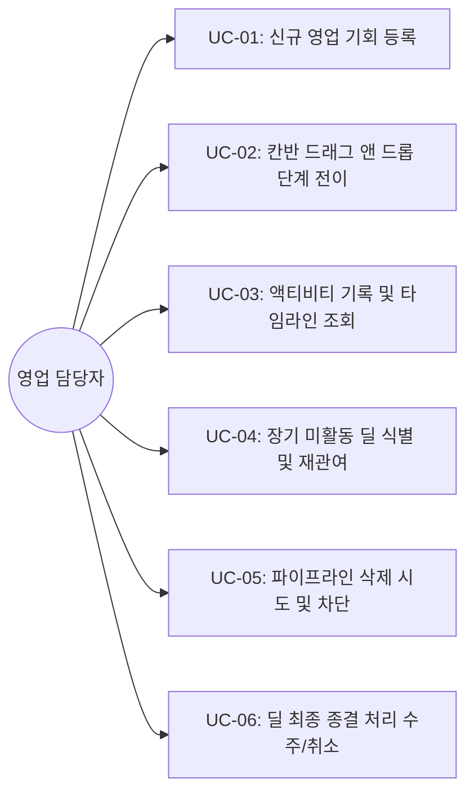

# 유스케이스 명세서 (UC.md - Use Case Specification)

> **문서 목적**: [FD.md](file:///c:/VIBECD/PRJ2/FD.md)의 기능 요구사항과 글로벌 CRM(Pipedrive, HubSpot, Salesforce 등)의 **베스트 프랙티스**를 반영하여, 시스템과 사용자 간의 상호작용 시나리오를 표준 유스케이스 형식으로 기술한 문서입니다.  
> **관련 문서**: [AGENTS.md](file:///c:/VIBECD/PRJ2/AGENTS.md) | [FD.md](file:///c:/VIBECD/PRJ2/FD.md) | [docs/architecture.md](file:///c:/VIBECD/PRJ2/docs/architecture.md)

---

## 1. 글로벌 베스트 프랙티스 반영 기준 (Global Best Practices)

본 시스템은 Pipedrive, HubSpot 등 세계적인 세일즈 CRM 플랫폼의 핵심 파이프라인 관리 표준을 채택했습니다.

| 영역 | 글로벌 베스트 프랙티스 | 본 시스템 구현 및 반영 사항 |
| :--- | :--- | :--- |
| **Deal Rotting (딜 정체 관리)** | 활동 없이 방치된 딜은 파이프라인 예측을 왜곡하므로 시각적 경고 및 전용 필터 필수화 | 30일 무활동 시 `⚠️ 30일 미활동` 뱃지 및 상단 원클릭 필터 제공 |
| **Activity-Driven Sales** | 영업은 단계 이동보다 "다음 행동(Next Action)"의 연속적인 기록이 성공률을 좌우 | 전화, 미팅, 메일, 문자를 상세 모달 내 타임라인 표로 즉시 입력/조회 |
| **Data Hygiene (데이터 무결성)** | 감사 추적(Audit Trail) 및 실적 왜곡 방지를 위해 활동이 존재하는 딜은 삭제 금지 | 액티비티 존재 또는 상태 전이 이력 확인 시 삭제 버튼 비활성화 & 백엔드 차단 |
| **Kanban Streamlining** | 단계는 4~7개로 명확한 구매자 전환 단계(Exit Criteria)를 표현해야 함 | 리드 $\rightarrow$ 제안 $\rightarrow$ 미팅 $\rightarrow$ 협상 $\rightarrow$ 마무리(수주) / 취소(실패) 6단계 표준화 |

---

## 2. 유스케이스 목록 (Use Case Index)

---

## 3. 상세 유스케이스 명세

### UC-01: 신규 영업 기회 등록 (Capture New Deal)
- **식별자**: `UC-01`
- **주 액터**: 영업 담당자
- **설명**: 새로운 잠재 고객사와의 영업 기회가 발생했을 때 기본 정보와 예상 금액을 입력하여 파이프라인에 등록한다.
- **선행 조건**: 시스템 메인 칸반보드 화면에 접속해 있음.
- **기본 흐름 (Main Flow)**:
  1. 담당자가 상단 우측 `[+ 새 파이프라인 등록]` 버튼을 클릭한다.
  2. 시스템이 입력 모달(제목, 고객사명, 예상 금액, 초기 단계, 담당자, 목표 마감일)을 팝업한다.
  3. 담당자가 필수 정보를 입력하고 `[등록]`을 클릭한다.
  4. 프론트엔드가 JSON 페이로드를 구성하여 API Gateway(`POST /api/pipelines`)로 전송한다.
  5. Gateway가 파이프라인 마이크로서비스로 라우팅하고, SQLite DB(`pipelines.sqlite`)에 저장한다.
  6. 시스템이 등록 성공 응답(200 OK)을 반환하고, 칸반보드의 해당 컬럼에 신규 카드를 즉시 추가하며 컬럼 합계 금액/건수를 갱신한다.
- **예외 흐름 (Exception Flow)**:
  - 3a. 필수 입력 항목(고객사명, 딜 제목 등)이 누락되었거나 금액이 음수인 경우:
    - 시스템은 폼 제출을 중단하고 해당 입력창 아래에 붉은색 안내 메시지를 표시한다.
- **사후 조건**: 신규 파이프라인 레코드가 생성되고 초기 상태(`LEAD` 등)로 칸반보드에 표시된다.

---

### UC-02: 칸반 드래그 앤 드롭 단계 전이 (Progress Deal via Drag & Drop)
- **식별자**: `UC-02`
- **주 액터**: 영업 담당자
- **설명**: 고객과의 영업이 진척됨에 따라 카드를 마우스로 끌어 다음 단계 컬럼으로 이동시킨다.
- **선행 조건**: 칸반보드에 1개 이상의 파이프라인 카드가 표시되어 있음.
- **기본 흐름 (Main Flow)**:
  1. 담당자가 특정 파이프라인 카드를 클릭한 채 다른 단계 컬럼(예: '리드' $\rightarrow$ '제안')으로 드래그하여 드롭한다.
  2. 프론트엔드가 드래그 성공 이벤트를 감지하고 UI 상의 카드를 목적지 컬럼으로 즉시 이동시킨다.
  3. 프론트엔드가 API Gateway로 상태 변경 JSON 요청(`PATCH /api/pipelines/:id/status`)을 보낸다.
  4. 파이프라인 서비스가 DB의 상태값(`status`)과 최종 수정일시(`updated_at`)를 갱신한다.
  5. 출발 컬럼과 도착 컬럼의 건수 및 합계 금액이 실시간으로 재계산되어 표시된다.
- **대안/예외 흐름**:
  - 4a. 네트워크 단절 또는 백엔드 응답 실패 시:
    - 프론트엔드는 카드 위치를 드래그 이전 원래 컬럼으로 롤백(Rollback)하고 "상태 변경 저장 실패" 알림을 표시한다.
- **사후 조건**: 파이프라인의 상태가 변경되고, 초기 상태와 달라졌으므로 이후 삭제가 차단된다.

---

### UC-03: 액티비티 기록 및 타임라인 조회 (Log Sales Activity)
- **식별자**: `UC-03`
- **주 액터**: 영업 담당자
- **설명**: 미팅, 전화 통화, 이메일, 문자 등 고객사와의 모든 접촉 이력을 기록하고 누적 타임라인을 확인한다.
- **선행 조건**: 칸반보드에서 특정 파이프라인 카드를 선택함.
- **기본 흐름 (Main Flow)**:
  1. 담당자가 파이프라인 카드를 클릭하여 상세 모달을 연다.
  2. 프론트엔드가 API Gateway를 통해 액티비티 서비스(`GET /api/activities?pipeline_id=...`)에서 기존 활동 목록 JSON을 가져와 최신순 표 형태로 렌더링한다.
  3. 담당자가 모달 내 활동 입력창에서 활동 유형(📞 전화 / ✉️ 메일 / 💬 문자 / 📌 기타), 일시, 상세 내용을 입력하고 `[활동 추가]`를 누른다.
  4. 프론트엔드가 API Gateway를 거쳐 액티비티 서비스(`POST /api/activities`)로 등록 요청을 전송한다.
  5. 액티비티 서비스가 DB(`activities.sqlite`)에 기록하고, 파이프라인 서비스에 활동 발생 사실을 동기화(최종 활동일 갱신)한다.
  6. 모달 내 활동 표 맨 위에 방금 입력한 내역이 즉시 추가된다.
- **사후 조건**: 액티비티가 1건 이상 기록되었으므로, 해당 파이프라인은 데이터 무결성 규칙에 의해 삭제가 영구 차단된다. 또한 30일 미활동 타이머가 리셋된다.

---

### UC-04: 장기 미활동 딜(Deal Rotting) 식별 및 재관여 (Identify Stale Deals)
- **식별자**: `UC-04`
- **주 액터**: 영업 담당자
- **설명**: 30일 동안 어떠한 영업 활동이나 단계 전이가 없어 방치된 '위험 딜'을 빠르게 식별하여 고객 재접촉을 유도한다.
- **선행 조건**: 최종 활동(또는 생성) 후 30일이 초과된 파이프라인이 존재함.
- **기본 흐름 (Main Flow)**:
  1. 파이프라인 서비스가 목록 반환 시 `(현재일자 - 최종활동일) >= 30일`인 건에 대해 `is_inactive_30d: true` 플래그를 설정하여 JSON으로 전달한다.
  2. 프론트엔드는 해당 카드 우측 상단에 붉은색 **`⚠️ 30일 미활동`** 뱃지를 달고 카드 테두리를 하이라이트한다.
  3. 담당자는 화면 상단의 `[⚠️ 주의 필요한 딜 모아보기 (N건)]` 필터 토글 버튼을 클릭한다.
  4. 칸반보드에 30일 이상 방치된 카드들만 압축 표시된다.
  5. 담당자는 방치된 카드를 열어 즉시 새 전화/이메일 액티비티를 기록하거나(UC-03), 진척이 불가능한 경우 취소(실패) 단계로 이동시킨다(UC-06).
  6. 새로운 활동이 기록되면 30일 미활동 플래그가 즉시 해제되어 일반 카드로 정상 환원된다.
- **사후 조건**: 방치된 잠재 매출 누수를 방지하고 파이프라인의 정확도를 유지한다.

---

### UC-05: 파이프라인 안전 삭제 시도 및 데이터 무결성 보호 (Prevent Invalid Deletion)
- **식별자**: `UC-05`
- **주 액터**: 영업 담당자
- **설명**: 잘못 생성된 빈 딜은 삭제할 수 있으나, 활동 이력이 있거나 단계가 진행된 유의미한 영업 데이터는 영구 보존한다.
- **선행 조건**: 담당자가 상세 모달을 열어 삭제를 검토함.
- **시나리오 A: 삭제 불가 (정상적인 보호 흐름)**:
  1. 파이프라인에 액티비티가 1건 이상 존재하거나, 초기 상태(예: 리드)에서 한 번이라도 상태가 변경된 경우.
  2. 프론트엔드 상세 모달의 `[삭제]` 버튼이 **비활성화(Disabled)** 상태로 표시된다.
  3. 마우스 커서를 올리면 *"활동 이력이 존재하거나 단계가 변경된 영업건은 삭제할 수 없습니다"* 안내 툴팁이 노출된다.
  4. (비정상 우회 호출 방어) 사용자가 API 도구로 직접 `DELETE /api/pipelines/:id`를 호출하더라도, 파이프라인 서비스가 액티비티 서비스와 검증하여 `400 Bad Request` 에러 JSON을 반환한다.
- **시나리오 B: 단순 오입력 삭제 허용**:
  1. 방금 생성된 직후이며, 액티비티가 0건이고, 상태도 최초 상태 그대로인 경우.
  2. 상세 모달의 `[삭제]` 버튼이 활성화 상태로 노출된다.
  3. 담당자가 클릭 시 "정말 삭제하시겠습니까?" 재확인 후 안전하게 삭제되고 칸반보드에서 제거된다.
- **사후 조건**: 회사의 소중한 영업 이력 데이터가 실수나 임의 조작으로 유실되지 않는다.

---

### UC-06: 딜 최종 종결 처리 (Close Deal as Won or Lost)
- **식별자**: `UC-06`
- **주 액터**: 영업 담당자
- **설명**: 협상이 성공하여 계약이 성사되거나, 반대로 실패/중단된 영업건을 최종 마무리한다.
- **기본 흐름 (Main Flow)**:
  1. 담당자가 협상 중인 카드를 **[마무리]** (수주 성공) 또는 **[취소]** (실패/보류) 컬럼으로 드래그한다.
  2. 시스템이 마감 처리일자(`closing_date` 또는 `canceled_date`)를 현재 일시로 기록한다.
  3. 수주/취소로 종결된 카드는 30일 미활동 경고 대상에서 자동으로 제외된다.
- **사후 조건**: 파이프라인이 완결 상태로 전환되고 전체 수주/실패 집계에 반영된다.
