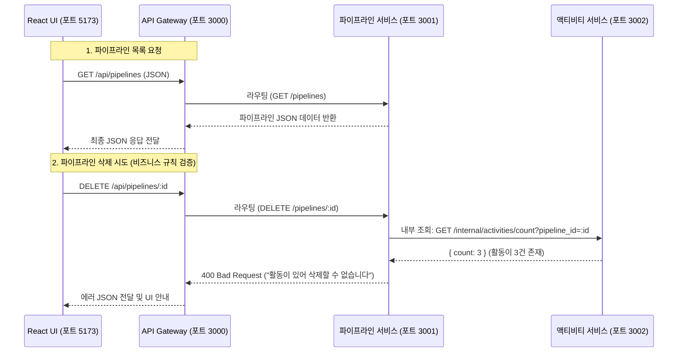

# JSON API 명세서 및 통신 가이드 (docs/api_specs.md)

> **문서 목적**: React 프론트엔드가 API Gateway(`http://localhost:3000`)를 통해 백엔드 마이크로서비스들과 주고받는 JSON 데이터 형식을 정리한 실전 가이드입니다.

---

## 1. 통신 원리 한눈에 보기



---

## 2. 공통 응답 규격 (Common JSON Envelope)

모든 API 응답은 일관성 있게 아래 형태를 가집니다.

```json
{
  "success": true,          // 성공 여부 (true / false)
  "data": { ... },          // 실제 전달되는 데이터 (객체 또는 배열)
  "message": "안내 메시지"  // 성공 또는 에러 설명
}
```

---

## 3. 파이프라인 API (`/api/pipelines`)

### 3.1. 파이프라인 전체 목록 조회
- **Method**: `GET`
- **Path**: `/api/pipelines`
- **응답 (Response)**:
```json
{
  "success": true,
  "data": [
    {
      "id": "pipe-001",
      "title": "ERP 시스템 교체 프로젝트",
      "client_name": "(주)삼성물산",
      "amount": 50000000,
      "status": "PROPOSAL",
      "initial_status": "LEAD",
      "created_by": "홍길동",
      "closing_date": "2026-12-15",
      "created_at": "2026-10-01T09:00:00Z",
      "updated_at": "2026-10-05T14:30:00Z",
      "is_inactive_30d": true,
      "activity_count": 2
    }
  ]
}
```

### 3.2. 새 파이프라인 등록
- **Method**: `POST`
- **Path**: `/api/pipelines`
- **요청 Body**:
```json
{
  "title": "AI 챗봇 도입 건",
  "client_name": "(주)카카오엔터프라이즈",
  "amount": 18000000,
  "status": "LEAD",
  "created_by": "김영업",
  "closing_date": "2026-11-30"
}
```

### 3.3. 파이프라인 단계 변경 (칸반 카드 드래그 시)
- **Method**: `PATCH`
- **Path**: `/api/pipelines/:id/status`
- **요청 Body**:
```json
{
  "status": "MEETING"
}
```

### 3.4. 파이프라인 삭제
- **Method**: `DELETE`
- **Path**: `/api/pipelines/:id`
- **비즈니스 제약조건 위반 시 에러 응답 (400 Bad Request)**:
```json
{
  "success": false,
  "message": "활동 이력이 존재하거나 상태가 변경된 영업건은 삭제할 수 없습니다."
}
```

---

## 4. 액티비티 API (`/api/activities`)

### 4.1. 특정 파이프라인의 활동 목록 조회 (상세 팝업용)
- **Method**: `GET`
- **Path**: `/api/activities?pipeline_id=pipe-001`
- **응답 (Response)**:
```json
{
  "success": true,
  "data": [
    {
      "id": "act-101",
      "pipeline_id": "pipe-001",
      "activity_date": "2026-10-05 14:00",
      "activity_type": "MEETING",
      "assignee": "홍길동",
      "content": "담당 부서장 대면 미팅 진행. 1차 견적서 전달 완료.",
      "created_at": "2026-10-05T14:10:00Z"
    },
    {
      "id": "act-102",
      "pipeline_id": "pipe-001",
      "activity_date": "2026-10-02 10:30",
      "activity_type": "CALL",
      "assignee": "홍길동",
      "content": "도입 일정 유선 확인. 11월 내 의사결정 예정.",
      "created_at": "2026-10-02T10:35:00Z"
    }
  ]
}
```

### 4.2. 새 액티비티 등록
- **Method**: `POST`
- **Path**: `/api/activities`
- **요청 Body**:
```json
{
  "pipeline_id": "pipe-001",
  "activity_date": "2026-11-08 11:30",
  "activity_type": "EMAIL",
  "assignee": "홍길동",
  "content": "수정 견적서 및 도입 사례 PDF 이메일 발송"
}
```
