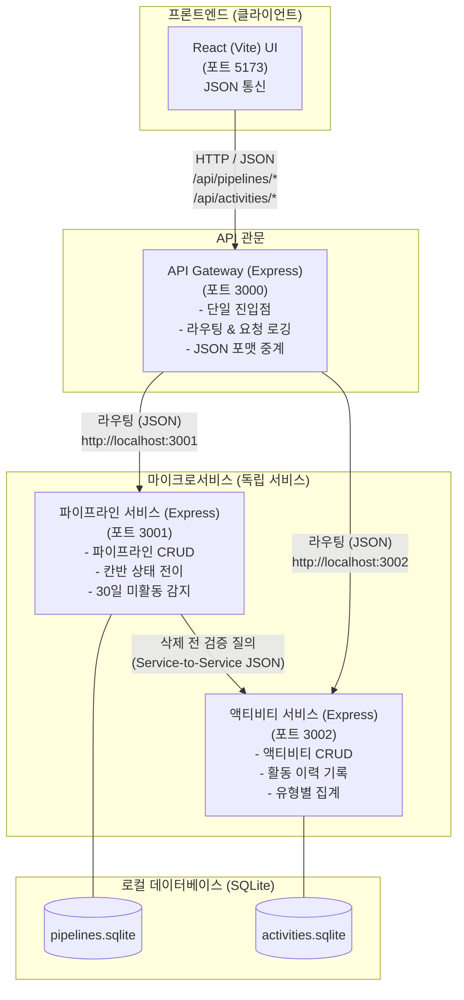

# 영업 파이프라인 관리 시스템 상세 설계서 (docs/architecture.md)

> **문서 버전**: v1.1 (사용자 인터뷰 결과 및 MSA/API Gateway 학습 목표 반영)  
> **기준 지침**: [AGENTS.md](file:///c:/VIBECD/PRJ2/AGENTS.md)

---

## 1. 프로젝트 개요 및 학습 목표

- **목적**: 1인 사용자를 위한 가볍고 직관적인 영업 파이프라인 칸반보드 웹 애플리케이션
- **핵심 학습 목표**:
  1. **React $\leftrightarrow$ JSON REST 통신**: 프론트엔드가 백엔드와 표준 JSON 데이터 포맷으로 데이터를 주고받는 방식 습득.
  2. **API Gateway 패턴**: 프론트엔드의 모든 요청을 단일 관문(Gateway)에서 받아 적절한 마이크로서비스로 라우팅하는 구조 이해.
  3. **경량 MSA (Microservices Architecture)**: 파이프라인 서비스와 액티비티 서비스를 기능별로 독립 분리하여 설계·운영하는 실전 경험.

---

## 2. 시스템 아키텍처 (경량 MSA & API Gateway)

초보자도 복잡한 쿠버네티스나 외부 클라우드 없이 **내 PC(로컬)에서 Node.js만으로 가볍게 실습할 수 있는 경량 MSA 구조**입니다.



### 2.1. 계층별 역할 및 기술 스택

| 구분 | 포트 | 사용 기술 | 담당 역할 |
| :--- | :---: | :--- | :--- |
| **프론트엔드** | `5173` | React, Vite, TailwindCSS | 사용자 인터페이스, 칸반보드 드래그 앤 드롭, 상세 팝업 모달, JSON API 호출 |
| **API Gateway** | `3000` | Node.js (Express), `http-proxy-middleware` | 프론트엔드의 모든 API 요청을 받아 해당 서비스로 전달, 공통 CORS/로깅 처리 |
| **파이프라인 서비스** | `3001` | Node.js (Express), SQLite | 영업 기회 생성/조회/수정/삭제, 단계 변경, 30일 미활동 자동 판별 |
| **액티비티 서비스** | `3002` | Node.js (Express), SQLite | 영업 활동(전화, 메일, 문자 등) 기록/조회, 파이프라인별 활동 개수 제공 |

---

## 3. JSON 통신 및 데이터 흐름 이해

### 3.1. 요청/응답 표준 JSON 규격
프론트엔드와 모든 백엔드 서비스는 항상 아래와 같은 표준 JSON 형식으로 대화합니다.

#### [요청 (Request Body 예시: 새 파이프라인 등록)]
```json
POST /api/pipelines HTTP/1.1
Content-Type: application/json

{
  "title": "클라우드 마이그레이션 계약건",
  "client_name": "(주)에이비씨",
  "amount": 25000000,
  "status": "LEAD",
  "created_by": "영업담당A",
  "closing_date": "2026-12-31"
}
```

#### [응답 (Response Body 예시: 표준 공통 포맷)]
```json
HTTP/1.1 200 OK
Content-Type: application/json

{
  "success": true,
  "data": {
    "id": "pipe-101",
    "title": "클라우드 마이그레이션 계약건",
    "client_name": "(주)에이비씨",
    "amount": 25000000,
    "status": "LEAD",
    "is_inactive_30d": false,
    "created_at": "2026-11-08T12:00:00Z"
  },
  "message": "파이프라인이 성공적으로 등록되었습니다."
}
```

---

## 4. 영업 프로세스 및 관리 규칙

### 4.1. 영업 파이프라인 6단계 (칸반 컬럼)
사용자가 지정한 6단계 흐름을 따릅니다.
1. **리드 (Lead)**: 초기 발굴 및 접촉
2. **제안 (Proposal)**: 솔루션 및 견적 제안
3. **미팅 (Meeting)**: 대면/온라인 미팅 및 데모
4. **협상 (Negotiation)**: 조건 및 단가 협상
5. **마무리 (Closing / Won)**: 수주 성공 및 계약 완료
6. **취소 (Canceled / Lost)**: 딜 실패 또는 잠정 취소

### 4.2. 액티비티 4종류
- ✉️ **메일 (Email)**
- 📞 **전화 (Call)**
- 💬 **문자 (SMS)**
- 📌 **기타 (Other)**

### 4.3. 핵심 비즈니스 규칙 및 MSA 간 검증 (Critical Rules)
> [!IMPORTANT]
> **파이프라인 삭제 차단 불변 규칙**:
> 1. 해당 파이프라인에 **액티비티가 1건 이상 등록된 경우** 삭제 불가
> 2. 초기 생성 상태에서 **상태(Status)가 한 번이라도 변경된 경우** 삭제 불가
>
> **MSA 환경에서의 구현 방식**:
> - 사용자가 프론트에서 삭제 요청 시 $\rightarrow$ **API Gateway** 전달 $\rightarrow$ **파이프라인 서비스** 수신
> - **파이프라인 서비스**는 **액티비티 서비스**로 내부 HTTP 요청(`GET http://localhost:3002/internal/activities/count?pipeline_id=...`)을 보내 액티비티 개수를 확인
> - 1건 이상이거나 상태 변경 이력이 있으면 즉시 `400 Bad Request` 에러 JSON 반환

### 4.4. 30일 장기 미활동 딜 관리
- **감지 로직**: `(현재일자 - 최종 활동일자 또는 수정일자) >= 30일`
- **시각화**:
  - 칸반 카드 우측 상단에 붉은색 `⚠️ 30일 미활동` 뱃지 노출
  - 상단 필터바에 `[주의 필요한 딜 모아보기 (N건)]` 토글 버튼 제공

---

## 5. 프로젝트 디렉터리 구조 (MSA 적용)

```text
├── AGENTS.md                  # 전체 프로젝트 및 에이전트 작업 지침서
├── docs/
│   ├── architecture.md        # 본 시스템 설계 및 MSA 사양서
│   └── api_specs.md           # API Gateway 및 서비스별 JSON 명세서
├── package.json               # 루트 package.json (전체 서비스를 한 번에 실행하는 스크립트 포함)
├── services/                  # 백엔드 마이크로서비스 모음
│   ├── api-gateway/           # 포트 3000 (라우팅, 로깅, 프록시)
│   │   ├── src/
│   │   └── package.json
│   ├── pipeline-service/      # 포트 3001 (파이프라인 관리 & DB)
│   │   ├── src/
│   │   ├── data/pipelines.sqlite
│   │   └── package.json
│   └── activity-service/      # 포트 3002 (액티비티 관리 & DB)
│       ├── src/
│       ├── data/activities.sqlite
│       └── package.json
└── src/                       # 프론트엔드 (React + Vite, 포트 5173)
    ├── components/            # KanbanBoard, PipelineCard, DetailModal, ActivityTable
    ├── services/              # api.js (Gateway와 JSON 통신하는 함수들)
    └── types/
```

---

## 6. 초보자를 위한 1-Click 실행 가이드

여러 마이크로서비스를 각각 띄우는 번거로움을 없애기 위해, 루트에서 단 하나의 명령어로 전체 서비스가 동시에 실행되도록 구성합니다.

```bash
# 1. 의존성 설치 (최초 1회)
npm run setup

# 2. 전체 서비스 동시 실행 (Gateway + 파이프라인서비스 + 액티비티서비스 + React)
npm run dev
```

---

## 7. 단계별 개발 계획 (Next Steps)

1. **1단계**: [docs/api_specs.md](file:///c:/VIBECD/PRJ2/docs/api_specs.md)에 프론트엔드-백엔드 간 오가는 JSON 통신 규격 정의
2. **2단계**: 백엔드 경량 MSA 구성 (API Gateway + 2개 마이크로서비스 및 SQLite 연동)
3. **3단계**: React 프론트엔드 칸반보드 및 JSON 통신 연동 구현
4. **4단계**: 팝업 상세 모달(액티비티 표), 30일 미활동 경고 및 삭제 방지 규칙 통합 테스트
