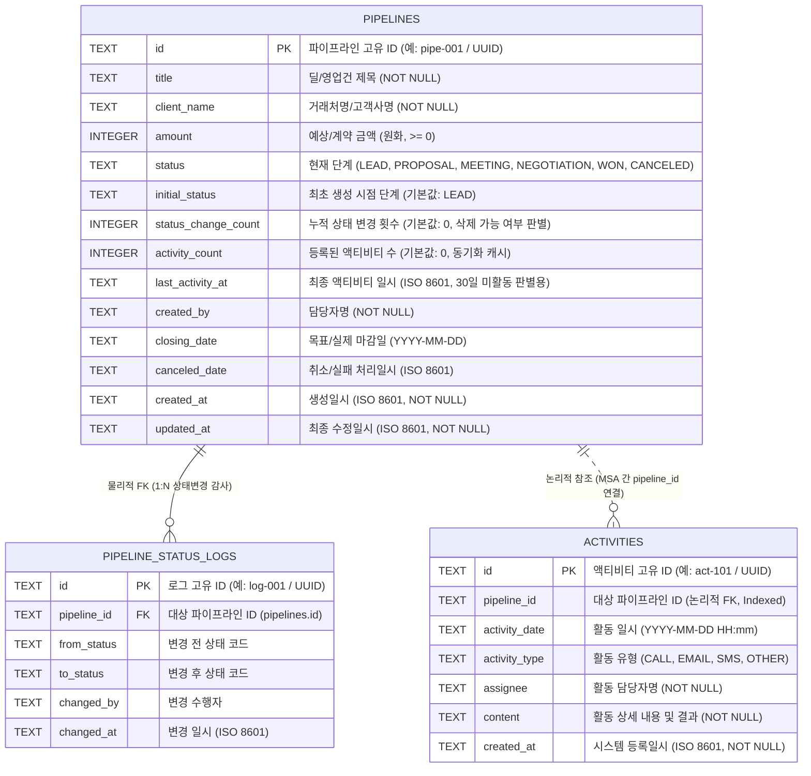

# 데이터베이스 설계서 (docs/db_design.md)

> **문서 목적**: '영업 파이프라인 관리 자동화 시스템'의 경량 MSA 아키텍처에 맞춘 데이터베이스 구조, 테이블 리스트, 상세 테이블 정의서, ERD, 코드 정의 및 비즈니스 규칙 검증 쿼리를 정의한 명세서입니다.  
> **관련 문서**: [AGENTS.md](file:///C:/AIDEV/PRJ2/AGENTS.md) | [docs/architecture.md](file:///C:/AIDEV/PRJ2/docs/architecture.md) | [docs/api_specs.md](file:///C:/AIDEV/PRJ2/docs/api_specs.md) | [FD.md](file:///C:/AIDEV/PRJ2/FD.md)

---

## 1. 데이터베이스 아키텍처 개요 (Database per Service)

본 프로젝트는 **경량 MSA(Microservices Architecture)** 원칙에 따라 서비스별로 독립된 로컬 **SQLite** 데이터베이스 파일을 사용합니다.

| 소속 서비스 | 포트 | DB 파일 경로 | 관리 영역 및 특징 |
| :--- | :---: | :--- | :--- |
| **파이프라인 서비스** (`pipeline-service`) | `3001` | `services/pipeline-service/data/pipelines.sqlite` | 영업 기회(파이프라인) 마스터 데이터 및 상태 변경 감사 이력 관리 |
| **액티비티 서비스** (`activity-service`) | `3002` | `services/activity-service/data/activities.sqlite` | 파이프라인별 영업 활동(전화, 메일, 문자, 기타) 이력 및 건수 집계 |

### 설계 핵심 원칙
1. **느슨한 결합 (Loose Coupling)**: 물리적으로 분리된 두 SQLite DB 간에는 직접적인 DB 외래키(Cross-DB Foreign Key)를 두지 않고, 논리적 식별자(`pipeline_id`)와 **서비스 간 내부 HTTP JSON 통신**으로 참조 무결성을 검증합니다.
2. **조회 성능과 정합성의 균형**:
   - 칸반보드 메인 화면 조회(`GET /api/pipelines`) 시 매번 액티비티 서비스를 호출하는 오버헤드를 줄이기 위해 `pipelines` 테이블에 `activity_count`와 `last_activity_at`을 비정규화(캐싱)하여 보관합니다.
   - 단, **파이프라인 삭제(`DELETE /api/pipelines/:id`)** 시에는 반드시 액티비티 서비스의 내부 API(`GET /internal/activities/count`)를 실시간 호출하여 이중 검증합니다.
3. **상태 변경 이력 완전 추적**: 상태가 `LEAD` -> `PROPOSAL` -> `LEAD`로 다시 되돌아온 경우에도 *"한 번이라도 상태가 변경된 경우 삭제 불가"* 규칙을 완벽하게 판별하기 위해 `status_change_count` 컬럼과 `pipeline_status_logs` 감사 테이블을 함께 운용합니다.

---

## 2. 테이블 리스트 (Table List)

| 번호 | 데이터베이스 | 테이블명 (영문) | 테이블명 (한글) | 주요 역할 및 설명 | 데이터 성격 |
| :---: | :--- | :--- | :--- | :--- | :---: |
| 1 | `pipelines.sqlite` | **`pipelines`** | 영업 파이프라인 | 영업 딜의 기본 정보, 예상 금액, 현재 단계, 30일 미활동 판별용 메타데이터 저장 | 마스터 |
| 2 | `pipelines.sqlite` | **`pipeline_status_logs`** | 파이프라인 상태 변경 이력 | 칸반 단계 이동 시 이전/이후 상태와 변경 일시를 기록하는 감사 로그(Audit Log) | 이력/로그 |
| 3 | `activities.sqlite` | **`activities`** | 영업 액티비티 | 고객 접촉 활동(전화, 메일, 문자, 기타) 상세 내역 및 활동 일시 저장 | 트랜잭션/이력 |

---

## 3. 개체-관계 다이어그램 (ERD)

> [!NOTE]
> `pipelines`와 `activities`는 서로 다른 마이크로서비스 DB에 위치하므로 **논리적 1:N 관계**를 가지며, `pipelines`와 `pipeline_status_logs`는 동일 DB 내 **물리적 1:N 관계(FK)**를 가집니다.



---

## 4. 상세 테이블 정의서 (Table Specifications)

### 4.1. `pipelines` (영업 파이프라인 테이블)
- **소속 DB**: `services/pipeline-service/data/pipelines.sqlite`
- **설명**: 칸반보드에 표시되는 개별 영업 기회(딜) 정보를 관리합니다.

| 순번 | 컬럼명 | 한글명 | 타입 (SQLite) | 필수 | 기본값 | 키/제약조건 | 상세 설명 |
| :---: | :--- | :--- | :---: | :---: | :---: | :--- | :--- |
| 1 | `id` | 파이프라인 ID | `TEXT` | Y | - | `PRIMARY KEY` | 고유 식별자 (예: `pipe-001` 또는 UUID) |
| 2 | `title` | 딜 제목 | `TEXT` | Y | - | `LENGTH >= 2` | 영업 기회 제목 (2자 이상 필수) |
| 3 | `client_name` | 거래처명 | `TEXT` | Y | - | - | 고객사/거래처 이름 |
| 4 | `amount` | 예상 금액 | `INTEGER` | Y | `0` | `CHECK(amount >= 0)` | 원화(₩) 기준 예상/계약 금액 |
| 5 | `status` | 현재 진행 단계 | `TEXT` | Y | `'LEAD'` | Enum 제약 | `LEAD`, `PROPOSAL`, `MEETING`, `NEGOTIATION`, `WON`, `CANCELED` |
| 6 | `initial_status` | 최초 생성 단계 | `TEXT` | Y | `'LEAD'` | 수정 불가 | 파이프라인 최초 등록 당시의 `status` 값 |
| 7 | `status_change_count` | 상태 변경 횟수 | `INTEGER` | Y | `0` | `>= 0` | 단계가 변경될 때마다 `+1` 증가 (`> 0`이면 삭제 불가) |
| 8 | `activity_count` | 활동 등록 건수 | `INTEGER` | Y | `0` | `>= 0` | 액티비티 추가 시 동기화 (`> 0`이면 삭제 불가) |
| 9 | `last_activity_at` | 최종 활동 일시 | `TEXT` | N | `NULL` | ISO 8601 / DateTime | 가장 최근 액티비티가 등록/수행된 일시 |
| 10 | `created_by` | 생성자(담당자) | `TEXT` | Y | - | - | 영업 담당자 이름 또는 ID |
| 11 | `closing_date` | 목표 마감일 | `TEXT` | N | `NULL` | `YYYY-MM-DD` | 예상 수주일 또는 수주 완료(`WON`) 처리일 |
| 12 | `canceled_date` | 취소 처리일시 | `TEXT` | N | `NULL` | ISO 8601 | 취소/실패(`CANCELED`) 단계 진입 일시 |
| 13 | `created_at` | 생성일시 | `TEXT` | Y | `CURRENT_TIMESTAMP` | ISO 8601 | 레코드 최초 생성 시각 |
| 14 | `updated_at` | 최종 수정일시 | `TEXT` | Y | `CURRENT_TIMESTAMP` | ISO 8601 | 정보 수정 또는 상태 변경 시각 |

> [!TIP]
> **가상/계산 필드 (`is_inactive_30d`, `can_delete`)**:  
> DB에 고정 저장하지 않고, 조회 시점(`GET /api/pipelines`)에 현재 시각 기준으로 실시간 계산하여 응답 JSON에 포함합니다. (상세 계산식은 6장 참조)

---

### 4.2. `pipeline_status_logs` (파이프라인 상태 변경 이력 테이블)
- **소속 DB**: `services/pipeline-service/data/pipelines.sqlite`
- **설명**: [AGENTS.md](file:///C:/AIDEV/PRJ2/AGENTS.md) 7장(감사 로그 추적성 확보) 및 삭제 제한 규칙 검증을 위해 파이프라인의 모든 상태 전이를 기록합니다.

| 순번 | 컬럼명 | 한글명 | 타입 (SQLite) | 필수 | 기본값 | 키/제약조건 | 상세 설명 |
| :---: | :--- | :--- | :---: | :---: | :---: | :--- | :--- |
| 1 | `id` | 로그 ID | `TEXT` | Y | - | `PRIMARY KEY` | 상태 변경 이력 고유 식별자 |
| 2 | `pipeline_id` | 파이프라인 ID | `TEXT` | Y | - | `FOREIGN KEY` | `pipelines(id) ON DELETE CASCADE` (초기 오입력 삭제 시 함께 정리) |
| 3 | `from_status` | 이전 상태 | `TEXT` | Y | - | Enum 제약 | 변경 전 단계 코드 |
| 4 | `to_status` | 변경 상태 | `TEXT` | Y | - | Enum 제약 | 변경 후 단계 코드 |
| 5 | `changed_by` | 변경자 | `TEXT` | N | `'시스템/담당자'` | - | 상태 변경을 수행한 담당자 |
| 6 | `changed_at` | 변경일시 | `TEXT` | Y | `CURRENT_TIMESTAMP` | ISO 8601 | 상태 전이 발생 시각 |

---

### 4.3. `activities` (영업 액티비티 테이블)
- **소속 DB**: `services/activity-service/data/activities.sqlite`
- **설명**: 각 파이프라인에 대해 수행한 영업 활동(전화, 메일, 문자, 기타)을 기록합니다.

| 순번 | 컬럼명 | 한글명 | 타입 (SQLite) | 필수 | 기본값 | 키/제약조건 | 상세 설명 |
| :---: | :--- | :--- | :---: | :---: | :---: | :--- | :--- |
| 1 | `id` | 액티비티 ID | `TEXT` | Y | - | `PRIMARY KEY` | 활동 고유 식별자 (예: `act-101` 또는 UUID) |
| 2 | `pipeline_id` | 파이프라인 ID | `TEXT` | Y | - | `INDEX` (논리적 FK) | 대상 파이프라인의 `id` |
| 3 | `activity_date` | 활동 일시 | `TEXT` | Y | 현재 일시 | `YYYY-MM-DD HH:mm` | 실제 영업 활동이 수행된 일시 |
| 4 | `activity_type` | 활동 유형 | `TEXT` | Y | `'CALL'` | Enum 제약 | `CALL`, `EMAIL`, `SMS`, `OTHER` (하위 호환 `MEETING` 허용) |
| 5 | `assignee` | 담당자 | `TEXT` | Y | - | - | 활동을 수행한 영업 담당자명 |
| 6 | `content` | 활동 내용 | `TEXT` | Y | - | `LENGTH >= 1` | 활동 상세 내용 및 고객 반응 요약 |
| 7 | `created_at` | 등록일시 | `TEXT` | Y | `CURRENT_TIMESTAMP` | ISO 8601 | 시스템에 기록된 일시 |

---

## 5. 공통 코드 및 열거형(Enum) 정의서

### 5.1. 파이프라인 진행 상태 코드 (`pipelines.status`)
칸반보드의 좌측부터 우측 순서로 배치되는 6단계 표준 코드입니다.

| 순서 | 코드값 (DB/API) | 화면 표시명 (한글) | 단계 설명 | 30일 미활동 감지 대상 | 종결 여부 |
| :---: | :--- | :---: | :--- | :---: | :---: |
| 1 | `LEAD` | **리드** | 잠재 고객 발굴 및 초기 접촉 단계 | **대상 (Y)** | 진행 중 |
| 2 | `PROPOSAL` | **제안** | 고객 요구사항 파악 후 제안서/견적서 제출 | **대상 (Y)** | 진행 중 |
| 3 | `MEETING` | **미팅** | 대면/온라인 미팅 및 제품/솔루션 데모 진행 | **대상 (Y)** | 진행 중 |
| 4 | `NEGOTIATION` | **협상** | 계약 조건, 단가, 일정 등 실무 협상 진행 | **대상 (Y)** | 진행 중 |
| 5 | `WON` | **마무리** | 수주 성공 및 계약 체결 완료 (`closing_date` 기록) | 제외 (N) | **종결 (성공)** |
| 6 | `CANCELED` | **취소** | 영업 실패, 고객사 프로젝트 중단/보류 (`canceled_date` 기록) | 제외 (N) | **종결 (실패/취소)** |

### 5.2. 액티비티 유형 코드 (`activities.activity_type`)
[FD.md](file:///C:/AIDEV/PRJ2/FD.md) 및 [docs/architecture.md](file:///C:/AIDEV/PRJ2/docs/architecture.md)에서 정의한 4대 기본 활동 유형입니다. ([docs/api_specs.md](file:///C:/AIDEV/PRJ2/docs/api_specs.md) 예시 데이터의 `MEETING` 코드도 호환 지원합니다.)

| 코드값 (DB/API) | 화면 표시명 | 아이콘 | 설명 |
| :--- | :---: | :---: | :--- |
| `CALL` | **전화** | 📞 | 유선 통화, 일정 확인, 안부 및 니즈 파악 |
| `EMAIL` | **메일** | ✉️ | 제안서, 견적서, 소개 자료, 계약서 이메일 발송 |
| `SMS` | **문자** | 💬 | 문자 메시지, 메신저(카카오톡 등) 안내 발송 |
| `OTHER` | **기타** | 📌 | 대면 미팅, 온라인 화상회의, 세미나 등 기타 영업 활동 |
| *(호환)* `MEETING` | **미팅(기타)** | 🤝 / 📌 | 시드 데이터 및 API 명세 예시 호환용 코드 |

---

## 6. 핵심 비즈니스 로직 및 DB 검증 규칙

### 6.1. 파이프라인 삭제 불가 불변 규칙 (Critical Rule)
> [!IMPORTANT]
> **삭제 가능 조건 (`can_delete === true`)**:
> 아래 3가지 조건을 **모두** 만족할 때만 삭제가 허용됩니다.
> 1. `activity_count == 0` (액티비티 서비스 실시간 조회 결과도 `0건`이어야 함)
> 2. `status == initial_status` (현재 상태가 최초 생성 상태와 동일)
> 3. `status_change_count == 0` (과거에 다른 단계로 이동했다가 돌아온 이력도 없어야 함)

- **삭제 검증 시퀀스 (`DELETE /api/pipelines/:id`)**:
  1. `pipeline-service`가 `pipelines` 테이블에서 대상 레코드의 `status`, `initial_status`, `status_change_count`를 조회합니다.
  2. `status !== initial_status` 또는 `status_change_count > 0`이면 즉시 `400 Bad Request`를 반환합니다.
  3. `activity-service`의 내부 엔드포인트(`GET http://localhost:3002/internal/activities/count?pipeline_id=:id`)를 호출해 실제 DB(`activities.sqlite`)의 `COUNT(*)`를 확인합니다.
  4. `count > 0`이면 즉시 `400 Bad Request`를 반환합니다.
  5. 모든 조건을 통과한 경우에만 `DELETE FROM pipelines WHERE id = ?`를 실행합니다.

### 6.2. 30일 장기 미활동 딜(`is_inactive_30d`) 판별 로직
- **기준 일시 (`reference_date`)**:
  - 등록된 액티비티가 있는 경우: `last_activity_at` (최신 액티비티 활동일시)
  - 등록된 액티비티가 없는 경우: `created_at` (파이프라인 최초 생성일시)
- **판별 조건**:
  - `status NOT IN ('WON', 'CANCELED')` (진행 중인 딜만 대상)
  - `(현재시각 - COALESCE(last_activity_at, created_at)) >= 30일`
- **신규 액티비티 등록 시 MSA 동기화 흐름**:
  - 사용자가 `POST /api/activities`로 새 활동을 등록하면, `activity-service`는 `activities` 테이블에 INSERT 후 `pipeline-service`의 내부 동기화 API(`PATCH http://localhost:3001/internal/pipelines/:id/activity-sync`)를 호출하여 `activity_count`와 `last_activity_at`을 즉시 갱신합니다. 이로써 30일 미활동 경고가 즉시 해제됩니다.

---

## 7. 인덱스(Index) 설계 및 DDL 명세

### 7.1. 인덱스 정의
| 데이터베이스 | 인덱스명 | 대상 테이블 및 컬럼 | 생성 목적 |
| :--- | :--- | :--- | :--- |
| `pipelines.sqlite` | `idx_pipelines_status` | `pipelines (status)` | 칸반보드 단계별 그룹핑 및 상태 필터링 속도 향상 |
| `pipelines.sqlite` | `idx_pipelines_created_at` | `pipelines (created_at DESC)` | 컬럼 내 최신 등록순 카드 정렬 최적화 |
| `pipelines.sqlite` | `idx_status_logs_pipeline_id` | `pipeline_status_logs (pipeline_id)` | 특정 파이프라인의 상태 변경 감사 이력 조회 최적화 |
| `activities.sqlite` | `idx_activities_pipeline_date` | `activities (pipeline_id, activity_date DESC)` | 상세 모달 오픈 시 해당 파이프라인의 활동을 최신순으로 즉시 조회 및 `COUNT(*)` 집계 최적화 |

### 7.2. SQLite 표준 DDL 스크립트

#### (1) 파이프라인 DB (`pipelines.sqlite`)
```sql
PRAGMA foreign_keys = ON;

-- 1. 영업 파이프라인 마스터 테이블
CREATE TABLE IF NOT EXISTS pipelines (
    id                  TEXT PRIMARY KEY,
    title               TEXT NOT NULL CHECK (length(trim(title)) >= 2),
    client_name         TEXT NOT NULL CHECK (length(trim(client_name)) >= 1),
    amount              INTEGER NOT NULL DEFAULT 0 CHECK (amount >= 0),
    status              TEXT NOT NULL DEFAULT 'LEAD'
                        CHECK (status IN ('LEAD', 'PROPOSAL', 'MEETING', 'NEGOTIATION', 'WON', 'CANCELED')),
    initial_status      TEXT NOT NULL DEFAULT 'LEAD'
                        CHECK (initial_status IN ('LEAD', 'PROPOSAL', 'MEETING', 'NEGOTIATION', 'WON', 'CANCELED')),
    status_change_count INTEGER NOT NULL DEFAULT 0 CHECK (status_change_count >= 0),
    activity_count      INTEGER NOT NULL DEFAULT 0 CHECK (activity_count >= 0),
    last_activity_at    TEXT NULL,
    created_by          TEXT NOT NULL,
    closing_date        TEXT NULL,
    canceled_date       TEXT NULL,
    created_at          TEXT NOT NULL DEFAULT (strftime('%Y-%m-%dT%H:%M:%SZ', 'now')),
    updated_at          TEXT NOT NULL DEFAULT (strftime('%Y-%m-%dT%H:%M:%SZ', 'now'))
);

-- 2. 파이프라인 상태 변경 감사 로그 테이블
CREATE TABLE IF NOT EXISTS pipeline_status_logs (
    id          TEXT PRIMARY KEY,
    pipeline_id TEXT NOT NULL,
    from_status TEXT NOT NULL,
    to_status   TEXT NOT NULL,
    changed_by  TEXT DEFAULT '담당자',
    changed_at  TEXT NOT NULL DEFAULT (strftime('%Y-%m-%dT%H:%M:%SZ', 'now')),
    FOREIGN KEY (pipeline_id) REFERENCES pipelines(id) ON DELETE CASCADE
);

-- 인덱스 생성
CREATE INDEX IF NOT EXISTS idx_pipelines_status ON pipelines(status);
CREATE INDEX IF NOT EXISTS idx_pipelines_created_at ON pipelines(created_at DESC);
CREATE INDEX IF NOT EXISTS idx_status_logs_pipeline_id ON pipeline_status_logs(pipeline_id);
```

#### (2) 액티비티 DB (`activities.sqlite`)
```sql
-- 영업 액티비티 이력 테이블
CREATE TABLE IF NOT EXISTS activities (
    id            TEXT PRIMARY KEY,
    pipeline_id   TEXT NOT NULL,
    activity_date TEXT NOT NULL,
    activity_type TEXT NOT NULL DEFAULT 'CALL'
                  CHECK (activity_type IN ('CALL', 'EMAIL', 'SMS', 'OTHER', 'MEETING')),
    assignee      TEXT NOT NULL,
    content       TEXT NOT NULL CHECK (length(trim(content)) >= 1),
    created_at    TEXT NOT NULL DEFAULT (strftime('%Y-%m-%dT%H:%M:%SZ', 'now'))
);

-- 파이프라인별 최신순 활동 조회 및 카운트용 복합 인덱스
CREATE INDEX IF NOT EXISTS idx_activities_pipeline_date
    ON activities(pipeline_id, activity_date DESC, created_at DESC);
```

---

## 8. 초기 시드 데이터(Seed Data) 설계

[AGENTS.md](file:///C:/AIDEV/PRJ2/AGENTS.md) 7장(재실행성 보장) 및 모든 유스케이스(`UC-01` ~ `UC-06`)를 실행 즉시 체험·검증할 수 있도록 DB 초기화 시 아래 시나리오별 기본 시드 데이터를 자동 적재합니다.

| 파이프라인 ID | 거래처명 / 딜 제목 | 단계 (`status`) | 초기 단계 | 활동 수 | 30일 미활동 | 삭제 가능 여부 및 검증 시나리오 |
| :--- | :--- | :---: | :---: | :---: | :---: | :--- |
| `pipe-001` | **(주)삼성물산** / ERP 시스템 교체 프로젝트 | `PROPOSAL` | `LEAD` | 2건 | **Y (`⚠️`)** | **삭제 불가** (활동 2건 + 상태 변경 이력 존재 + 30일 경과 경고 검증용) |
| `pipe-002` | **(주)카카오엔터프라이즈** / AI 챗봇 도입 건 | `LEAD` | `LEAD` | 0건 | N | **삭제 가능** (방금 등록된 초기 상태 & 활동 0건 — `UC-05` 시나리오 B 삭제 테스트용) |
| `pipe-003` | **현대오토에버** / 클라우드 보안 솔루션 구축 | `MEETING` | `LEAD` | 1건 | N | **삭제 불가** (활동 1건 및 단계 변경 — 최근 활동이 있어 정상 상태) |
| `pipe-004` | **LG CNS** / 차세대 빅데이터 분석 플랫폼 | `NEGOTIATION` | `LEAD` | 1건 | **Y (`⚠️`)** | **삭제 불가** (협상 단계에서 30일 이상 정체된 고액 딜 — `UC-04` 필터 테스트용) |
| `pipe-005` | **네이버클라우드** / 사내 그룹웨어 연동 개발 | `WON` | `LEAD` | 2건 | N (종결 제외) | **삭제 불가** (`마무리` 완료 딜 — 30일 경과했더라도 경고 뱃지 미표시 검증용) |
| `pipe-006` | **(주)우아한형제들** / 물류 자동화 대시보드 | `CANCELED` | `LEAD` | 1건 | N (종결 제외) | **삭제 불가** (`취소` 종결 딜 검증용) |
